## About me

I'm a B.Tech Computer Science (AI/ML) student at Lovely Professional University, Batch of 2027, preparing for technical placements. I work mainly in Python and C++, practise problem solving consistently, and learn by building: data analysis, machine learning models, and DevOps tooling.

- **Top 10 finish** at the Code-A-Haunt 24-hour hackathon (December 2024)
- **Kaggle certificates** in Python, Pandas and Data Visualization
- **HackerRank certificates** in JavaScript (Intermediate) and Problem Solving (Intermediate)

## Tech stack

| Area | Tools |
|:--|:--|
| **Languages** |  |
| **AI/ML and web** |  |
| **DevOps and cloud** |  |
| **Monitoring and tools** |  |

## Current focus

- Strengthening graphs and dynamic programming for placement interviews
- Improving ML workflows: preprocessing, feature engineering, and model evaluation
- Learning Docker, Kubernetes, Jenkins and AWS through hands-on projects

## DSA and problem solving

I built my foundations by working through Striver's A2Z DSA sheet from July 2024 to October 2025, using C++ for problem solving and covering topics such as graphs and dynamic programming.

## AI/ML and cybersecurity

**AI/ML.** I focus on the full workflow: cleaning messy data, engineering features, training classifiers such as Logistic Regression and Random Forest, and judging them with precision, recall and F1-score. I'm especially interested in applying AI to healthcare and agriculture.

**Cybersecurity.** This is a growing interest that I connect to the systems I build. In SysPulse, that means Trivy scan stages in Jenkins, a Kubernetes NetworkPolicy, and containers with a read-only root filesystem.

## Featured projects

### [SysPulse](https://github.com/Ankitpanghal01/SysPulse)

A DevOps learning project that wraps a browser-based monitoring dashboard in a containerised, Kubernetes-ready stack. The dashboard displays simulated metrics; the engineering focus is the infrastructure around it.

- **Containers:** Docker Compose stack with the app, Prometheus, Grafana, Alertmanager, Node Exporter and cAdvisor
- **Kubernetes:** rolling updates, an autoscaler for 2–10 pods, health probes, a PodDisruptionBudget and a NetworkPolicy
- **Infrastructure as code:** Terraform modules for an AWS VPC and EKS cluster, plus ECR and kube-prometheus-stack
- **CI/CD and monitoring:** Jenkins stages for linting, scanning, `kubectl` rollouts and smoke tests, with six Prometheus alert rules

**Stack:** Docker · Kubernetes · Jenkins · Terraform · AWS · Prometheus · Grafana · Nginx · JavaScript

### [English Premier League EDA](https://github.com/Ankitpanghal01/English-Premier-League-)

An exploratory notebook on Premier League player statistics. It filters incomplete records, converts percentage fields to numeric values, and isolates players with match appearances to prepare the data for analysis.

**Stack:** Python · pandas · Jupyter

### Jenkins practice

| Repository | What it covers |
|:--|:--|
| [jenkins-ci-pipeline](https://github.com/Ankitpanghal01/jenkins-ci-pipeline) | Declarative pipeline with install, test and build stages, plus status reporting |
| [jenkins-demo](https://github.com/Ankitpanghal01/jenkins-demo) | Minimal Python job for verifying that Jenkins pulls and runs code from GitHub |

My [portfolio](https://ankit-panghal.netlify.app/#projects) also covers the Lifestyle Disease Predictor and Competitive Programming Bank.

## GitHub activity

## Connect

| Profile | Link |
|:--|:--|
| **Portfolio** | [ankit-panghal.netlify.app](https://ankit-panghal.netlify.app/) |
| **LinkedIn** | [ankit-panghal01](https://www.linkedin.com/in/ankit-panghal01/) |
| **LeetCode** | [Ankitpanghal](https://leetcode.com/u/Ankitpanghal/) |
| **Codeforces** | [Ankitpanghal](https://codeforces.com/profile/Ankitpanghal) |
| **Email** | [myselfankitpanghal@gmail.com](mailto:myselfankitpanghal@gmail.com) |
